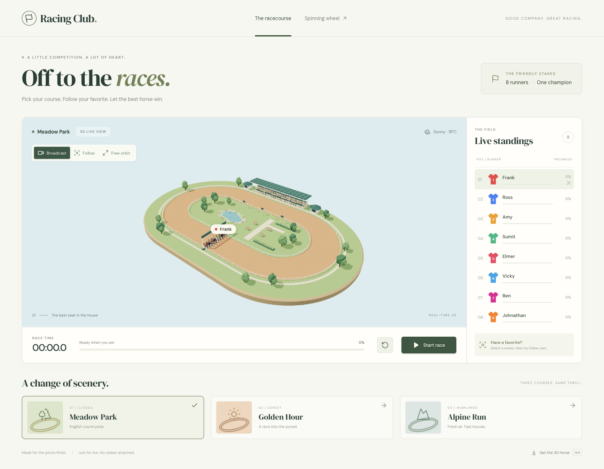
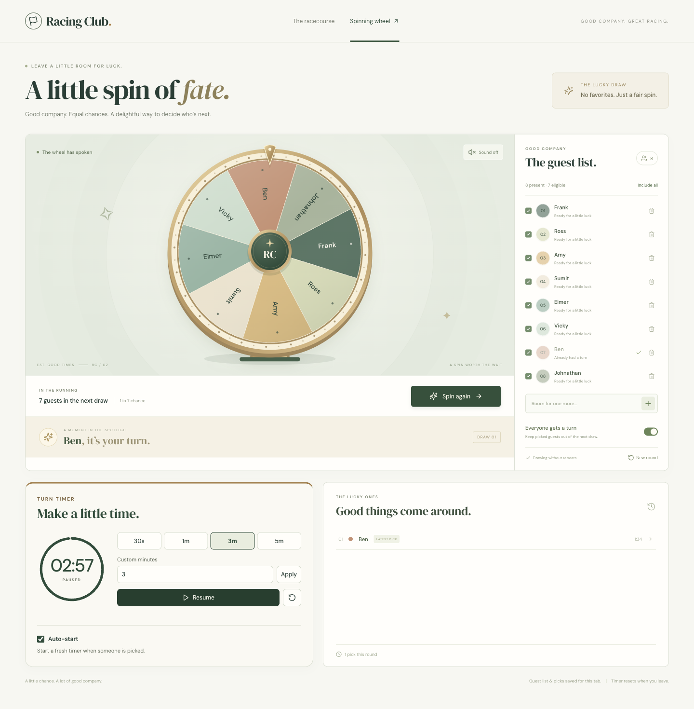

# Racing Club

A local-first racing and lucky-draw club built with React and TypeScript. Explore the Blender-authored 3D racecourse, or switch to the animated spinning wheel in the top navigation.



## Run

```sh
npm install
npm run dev
```

Open the Vite URL (normally `http://localhost:5173`). A WebGL-capable browser is required for the 3D view. Fonts and model assets are self-hosted; the scene makes no third-party requests.

## Play

- Choose **Meadow Park**, **Golden Hour**, or **Alpine Run** before racing. These are themed versions of the same oval course.
- **Start race** begins a three-second countdown and a roughly 35–43-second lap. Fresh speed profiles are sampled for each race; there are no betting mechanics.
- **Pause / Resume** freezes both progress and gallop. Leaving the browser tab automatically pauses the race. **Reset** returns everyone to the start.
- Select a runner in the standings, then choose **Follow** for a close-up. **Broadcast** frames the whole diorama; **Free orbit** supports drag and zoom.
- Results use exact crossing times, not render-frame order. Each lane is normalized to a lap so outer lanes do not inherently lose.
- Reduced-motion preferences disable gallop, dust, and camera easing while retaining the race simulation.

Edit `src/constants/participants.constant.ts` to change the shared participants. The race includes every listed participant, as the original race did; `present` / `selected` belong to the spinning wheel.

## The lucky draw

- A brass-rimmed SVG wheel with six turns of smooth deceleration, a fixed top pointer, and a confetti reveal. It does not require WebGL.
- Each eligible guest has an equal chance; Web Crypto supplies the random samples. The exact winning slice stays on screen after landing. The next spin rebuilds the wheel with the remaining eligible guests.
- Add up to **24 guests**, remove guests, or uncheck anyone sitting out. Duplicate new names are rejected; stable IDs distinguish entries internally. All roster/rule edits lock during a spin.
- **Everyone gets a turn** excludes previous winners. Switch it off to allow repeat picks. **New round** clears selections and history but keeps the guest list and attendance.
- The latest **50 picks** are shown in history. Roster, rules and picks are saved in **session storage for this tab**; a fresh session seeds the first 24 names from the shared participants file. Wheel edits do not change the horse-racing roster.
- The turn timer offers 30-second, 1-, 3-, and 5-minute presets, plus custom whole minutes (1–60). Pause/resume retains partial seconds. Its wall-clock deadline accounts for elapsed background/sleep time.
- **Auto-start** starts a fresh timer after each winner, not during the spin. Switch it off for manual timing. A new round resets the timer; leaving the wheel stops it. Navigating away during a spin cancels that unfinished draw.
- Sound is optional and off by default: locally synthesized ticks and a short winner chime, with no audio downloads. Reduced-motion mode reveals the result immediately without rotation or confetti.



Wheel implementation: `src/SpinningWheel.tsx`, `src/components/WheelDisc.tsx`, `src/components/TurnTimer.tsx`, and pure helpers in `src/wheel/model.ts`.

## Model and source

- `public/models/horse.glb` — downloadable 422 KB horse and jockey, 5,402 triangles, one seamless `Gallop` animation.
- `src/components/Horse.tsx` — typed, named component. Each horse has an independent animation mixer and recolorable coat/silks; shared geometry is cached.
- `src/components/RaceScene.tsx` — instanced course scenery, lighting, cameras, particles, and runners.
- `src/race/simulation.ts` — pure, frame-rate-independent race and oval geometry logic.
- `blender/horse.blend-cli.json` and `blender/horse.blend` — editable model sources.
- `blender/README.md` — regeneration instructions, material/node names, and validation details.
- `blender/previews/hero.png` — inspected model preview.

The GLB is +X-forward, +Y-up, grounded at Y=0, and contains no preview cameras, lights, or floor. To change appearance, edit the component's materials; to change geometry, rebuild the Blender asset.

## Verify

```sh
npm test                 # Node 22.6+; race, wheel, storage and timer tests
npm run lint
npm run build            # TypeScript project build + production bundle
node blender/verify_glb.mjs
```

The Three.js scene is lazy-loaded separately from the application shell and wheel. Vite may report a large-chunk warning for the 3D runtime; it does not prevent the build.

See [verification notes](docs/verification.md) for the browser and asset checks, including desktop/mobile screenshots.

`npm run deploy` builds and deploys to Cloudflare Pages using your configured Wrangler account. It is not run automatically.
